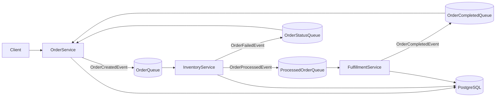

# Foodics Order Fulfillment — High-Level Design

## 1. Overview

An event-driven order fulfillment system composed of three services — Order, Inventory, and Fulfillment — that communicate asynchronously over RabbitMQ and persist state in PostgreSQL.

An order is created in OrderService, stock is decremented in InventoryService, a receipt is produced in FulfillmentService, and finally the order is marked complete back in OrderService. If stock is insufficient, the order is marked failed instead.

## 2. Goals & Non-Goals

**Goals**

- Demonstrate a decoupled, event-driven architecture across three independently runnable services.
- Decouple order placement from inventory and fulfillment work using asynchronous messaging.
- Guarantee that inventory is decremented exactly once per order and is idempotent.
- Keep message acknowledgement explicit (manual ack after successful processing).

**Non-Goals**

- Authentication and authorization.
- Payments and pricing logic beyond the catalog price snapshot.
- Horizontal scaling and load balancing.
- Dead-letter queues, retries with backoff, and circuit breakers.
- A dedicated database per service (a single shared database is used for simplicity).
- Centralized logging / observability (a local dev script is used instead).

## 3. Architecture



Services never call each other directly. All inter-service communication flows through RabbitMQ queues.

## 4. Components

### OrderService

Owns the customer order lifecycle and the product catalog (menu). It exposes a CRUD API for orders and a read API for products. When an order is created it publishes an `OrderCreatedEvent`. It consumes `OrderFailedEvent` (marks the order `Failed`) and `OrderCompletedEvent` (marks the order `Complete`).

### InventoryService

Tracks stock levels per product. It consumes `OrderCreatedEvent`, validates and decrements stock, and records the processed order for idempotency. On success it publishes `OrderProcessedEvent`; on failure (insufficient stock or unknown product) it publishes `OrderFailedEvent`.

### FulfillmentService

Generates receipts. It consumes `OrderProcessedEvent`, calculates the order total from line-item prices, stores the receipt, and publishes `OrderCompletedEvent` back to OrderService. It also exposes receipt read endpoints.

## 5. Data Flow

### Happy path

1. Client calls `POST /orders` on OrderService; the order is saved with status `Pending`.
2. OrderService publishes `OrderCreatedEvent` to `OrderQueue`.
3. InventoryService consumes it, checks idempotency, decrements stock, and records the processed order.
4. InventoryService publishes `OrderProcessedEvent` to `ProcessedOrderQueue`.
5. FulfillmentService consumes it, computes the total, stores the receipt, and publishes `OrderCompletedEvent` to `OrderCompletedQueue`.
6. OrderService consumes it and sets the order status to `Complete`.

### Failure path

1. As above, OrderService publishes `OrderCreatedEvent`.
2. InventoryService consumes it and finds insufficient stock (or an unknown product).
3. InventoryService publishes `OrderFailedEvent` (with a reason) to `OrderStatusQueue`.
4. OrderService consumes it, sets the order status to `Failed`, and stores the failure reason.

## 6. Messaging Design

RabbitMQ is used with direct exchanges and durable queues. Each message type has its own queue, so every lane is one-directional.

| Queue | Exchange | Routing key | Producer | Consumer |
|-------|----------|-------------|----------|----------|
| `OrderQueue` | `orders` | `order-exchange-routing` | OrderService | InventoryService |
| `OrderStatusQueue` | `order-status` | `order-status-routing` | InventoryService | OrderService |
| `ProcessedOrderQueue` | `order-processed` | `order-processed-routing` | InventoryService | FulfillmentService |
| `OrderCompletedQueue` | `order-completed` | `order-completed-routing` | FulfillmentService | OrderService |

**Why RabbitMQ instead of direct HTTP calls:** order placement should not block on (or fail because of) inventory and fulfillment. Messaging decouples the services in time — if a downstream service is down, messages simply queue up and are processed when it returns.

**Delivery semantics:** RabbitMQ provides at-least-once delivery. A message may be redelivered (e.g. on a crash between processing and ack), so consumers must be idempotent.

**Acknowledgement:** consumers use `autoAck: false` and acknowledge manually only after successful processing, so messages are not lost on failure.

## 7. Data Stores

A single PostgreSQL instance (`foodics` database) is shared, but each service owns its own tables through its own `DbContext` and only ever touches its own schema. Services exchange data exclusively through RabbitMQ — they never read or write each other's tables. EF Core migrations and seed data are applied automatically on service startup.

## 8. Key Design Decisions

| Decision | Choice | Why | Tradeoff |
|----------|--------|-----|----------|
| Service decomposition | Three services (Order, Inventory, Fulfillment) | Each owns one clear responsibility and can evolve/fail independently | More moving parts and operational complexity |
| Inter-service communication | Async messaging over RabbitMQ | Decouples order placement from downstream work; no blocking; resilience to downtime | Eventual consistency; harder to trace than a synchronous call |
| Queue layout | Separate queue per message direction | One-way lanes; no service reads back its own messages | More queues/exchanges to manage |
| Duplicate handling | Idempotency via a `ProcessedOrders` table keyed by `OrderId` | At-least-once delivery can redeliver; the key guarantees stock is decremented once | Extra table and a lookup per message |
| Acknowledgment | Manual ack (`autoAck: false`) | Message is only removed after successful processing | Consumer must implement ack/nack correctly |
| Database topology | One shared database, separate tables per service | Simpler for this scope; single `docker compose` Postgres | Weaker isolation than a DB-per-service model |

## 9. Deployment & Running

Local development uses `docker compose` for PostgreSQL and RabbitMQ, then a `run-all.sh` script that starts all three services and merges their logs into one prefixed view.

```bash
docker compose up -d   # Postgres + RabbitMQ
./run-all.sh           # all three services (migrations + seed run on startup)
```

Each service can also be run individually with `dotnet run`. Migrations and seed data apply automatically on startup, so no manual `dotnet ef database update` step is required.
