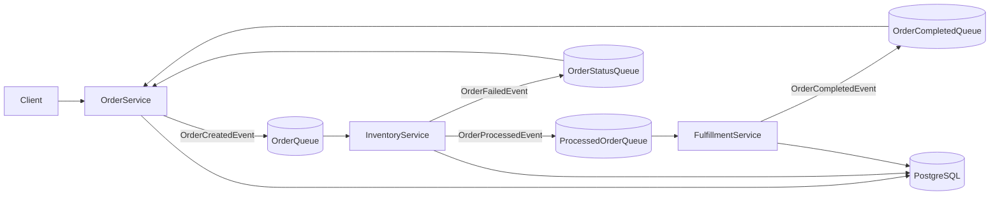

# Foodics Order Fulfillment

An event-driven order fulfillment system built with .NET microservices, RabbitMQ, and PostgreSQL.

## Overview

Three services collaborate to take an order from creation to completion:

- **OrderService** — manages customer orders and the product catalog.
- **InventoryService** — tracks stock and decrements it when orders are processed.
- **FulfillmentService** — generates receipts and marks orders complete.

Services communicate **asynchronously over RabbitMQ** — never through direct HTTP calls — and persist state in PostgreSQL.



## Documentation

- [High-Level Design](HLD.md) — architecture, components, data flow, and key design decisions.
- [Low-Level Design](LLD.md) — database schema, message contracts, queue topology, and consumer logic.
- Service READMEs:
  - [OrderService](OrderService/README.MD)
  - [InventoryService](InventoryService/README.MD)
  - [FulfillmentService](FulfillmentService/README.MD)

## Prerequisites

- .NET 10 SDK
- Docker (for PostgreSQL and RabbitMQ)

## Running locally

The fastest way is the `run-all.sh` script, which starts Postgres + RabbitMQ and runs all three services with color-coded, merged logs:

```bash
docker compose up -d   # start PostgreSQL + RabbitMQ
./run-all.sh           # run all three services (Ctrl+C to stop)
```

Or run each service in its own terminal:

```bash
cd OrderService && dotnet run
cd InventoryService && dotnet run
cd FulfillmentService && dotnet run
```

Database migrations and seed data apply automatically on service startup.

## Project structure

```
Foodics_Interview/
├── OrderService/         # orders + product catalog (publisher + status consumers)
├── InventoryService/     # stock + idempotent order processing
├── FulfillmentService/   # receipts + completion publishing
├── docker-compose.yml    # PostgreSQL + RabbitMQ
├── run-all.sh            # run everything with merged logs
├── HLD.md                # high-level design
└── LLD.md                # low-level design
```
